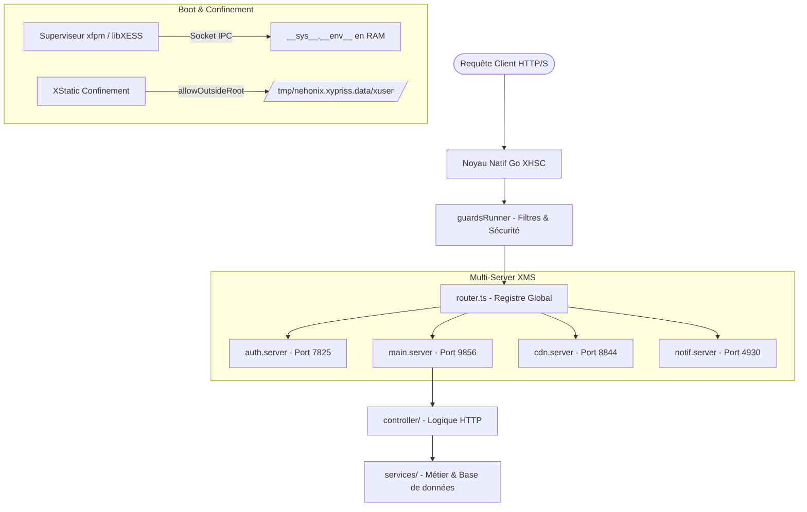

# RFC: Starter Template "Enterprise-Ready" pour `xfpm init`


## 1. Contexte & Motivation

### Le Constat
XyPriss dispose d'un moteur natif exceptionnel (**XHSC**, **libXESS**, **XTRS**, **XStatic**). Cependant, lorsqu'un nouveau développeur initialise un projet avec `xfpm init` :
* S'il démarre sur une structure trop minimaliste (un simple `index.ts` avec un "Hello World"), il se retrouve rapidement démuni face à l'organisation d'une application réelle d'envergure.
* Le développeur passe alors plusieurs jours à se poser des questions d'architecture : *Où placer les routes ? Comment structurer le multi-serveurs (XMS) ? Comment configurer proprement les guards ? Comment gérer le confinement des uploads temporaires avec XStatic ? Comment déclarer les variables d'environnement sans heurter le confinement Zero-Trust ?*
* Beaucoup risquent d'importer de mauvaises pratiques héritées d'Express (ex: `dotenv` classique, `process.env` sauvage, routes monolithiques non typées).

### L'Objectif
Intégrer dans `xfpm init` (ou via une option `xfpm init --template modular` / `--template enterprise`) une **architecture propre, modulaire et "clé en main"**.  
L'objectif est d'offrir une **Developer Experience (DX) immédiate** : le développeur lance `xfpm init`, et peut se concentrer instantanément sur sa **logique métier** (*Business Logic*) sans avoir à réfléchir à l'infrastructure.

---

## 2. Vue d'Ensemble de l'Architecture Proposée

Cette architecture est issue d'une implémentation réelle en production sur une plateforme commerciale d'envergure. Elle met en valeur toutes les forces de XyPriss :

```
project-root/
├── xypriss.config.jsonc      # Configuration déclarative centralisée ($vars, $internal, $env)
├── fileonix.config.json      # Configuration du watcher haute performance
├── package.json              # Dépendances & scripts xfpm
├── tsconfig.json             # Configuration TypeScript avec Path Aliases ("*": ["./src/*"])
├── .env                      # Variables d'environnement locales
└── src/
    ├── server.ts             # Point d'entrée unique & orchestration du boot
    ├── router.ts             # Registre global de routage
    │
    ├── configs/              # Configurations TypeScript du framework
    │   ├── xypriss.config.ts # Options du serveur (plugins, HTTP/2, cluster, rate-limit)
    │   ├── manifest.ts       # Métadonnées et identité du service
    │   └── xemsConfigs.ts    # Configuration du coffre sécurisé XEMS
    │   └── xncpDomainConfigs.ts    # Configuration du plugin xynginc pour le déploiement (avec une notice)
    │
    ├── servers/              # Définitions modulaires multi-serveurs (XMS Mode)
    │   ├── api.server.ts     # Serveur API REST principal
    │   ├── auth.server.ts    # Serveur d'authentification dédié
    │   └── cdn.server.ts     # Serveur de distribution statique & médias
    │
    ├── routes/               # Découpage des endpoints par domaine fonctionnel
    │   ├── auth.routes.ts
    │   ├── user.routes.ts
    │   ├── cdn.routes.ts
    │   └── ...
    │
    ├── controller/           # Contrôleurs HTTP (gestion requête / réponse)
    ├── services/             # Couche métier pure (accès base de données, emailing, etc.)
    │
    ├── guards/               # Sécurité & validation en amont (Guards Runners)
    │   ├── index.guard.ts    # Orchestrateur des guards
    │   ├── auth.guard.ts     # Vérification des sessions / tokens
    │   └── roles.guard.ts    # Contrôle d'accès basé sur les rôles (RBAC)
    │
    ├── schemas/              # Schémas de validation des requêtes (reliant-type / zod)
    ├── types/                # Déclarations et contrats d'interfaces TypeScript
    ├── const/                # Constantes immuables (timeouts, chemins, CDN)
    └── utils/                # Utilitaires réutilisables
        ├── crypto.ts         # Utilitaires pour des opérations de cryptographies
        ├── obj.ts            # Utilitaires pour des opérations de manipulations d'objects
        ├── str.ts
        ├── dateU.ts
```

---

## 3. Diagramme de Flux Architectural



---

## 4. Détail des Composants Clés & Bonnes Pratiques Intégrées

### A. Point d'entrée déclaratif (`src/server.ts`)
Le point d'entrée doit rester minimaliste, lisible et focalisé sur l'orchestration :

```typescript
import { createServer, XStatic } from "xypriss";
import { serverConfigs } from "./configs/xypriss.config";
import { router } from "router";
import { guardsRunner } from "guards/index.guard";
import { publicCdnPath, publicCdnTmpPath, permanentCdnPath } from "const/cdnPaths";

// 1. Initialisation de l'instance XyPriss
const app = createServer(serverConfigs);

// 2. Démarrage des guards de sécurité
guardsRunner();

// 3. Montage du routeur global
app.use("/", router);

// 4. Gestion sécurisée des fichiers statiques avec XStatic
const xs = new XStatic(app, __sys__);

// Dossier temporaire sécurisé (confiné dans tmpUserDir de XyPriss)
xs.define(publicCdnTmpPath, __sys__.path.tmpUserDir, {
  allowOutsideRoot: true,
  allowOutsideDir: false, // Impossible de remonter au-delà du bac à sable
});

// Dossier permanent de production
xs.define(publicCdnPath, permanentCdnPath, {
  allowOutsideRoot: false,
  allowOutsideDir: false,
});

// 5. Démarrage du serveur
app.start();
```

---

### B. Configuration déclarative Zero-Trust (`xypriss.config.jsonc`)
Le template pré-configure la whitelist `$env` pour éviter les faux-positifs de sécurité sur les outils de terminal :

```jsonc
{
  "$env": {
    "whitelist": [
      "NODE_DISABLE_COLORS",
      "NO_COLOR",
      "PORT",
      "NODE_ENV"
    ]
  },
  "$internal": {
    "xyphra": {
      "permissions": {
        "allowedHooks": [
          "XHS.HOOK.HTTP.REQUEST",
          "XHS.HOOK.LIFECYCLE.SERVER_START",
          "XHS.HOOK.HTTP.RESPONSE"
        ]
      }
    }
  },
  "$vars": {
    "__name__": "&(pkg).name",
    "__version__": "&(pkg).version",
    "__PORT__": "&(env).PORT"
  }
}
```

---

### C. Découpage XMS Multi-Serveurs (`src/servers/`)
Plutôt qu'un serveur monolithique, le template montre immédiatement comment isoler les contextes fonctionnels :
* `auth.server.ts` : Authentification et sessions.
* `api.server.ts` : API métier principale.
* `cdn.server.ts` : Distribution de contenus statiques.
* `notif.server.ts` : File d'attente et événements légers.

---

### D. Confort de Développement (`tsconfig.json`)
Configuration native des Path Aliases pour éliminer les `../../..` :

```json
{
  "compilerOptions": {
    "target": "ES2022",
    "module": "ESNext",
    "moduleResolution": "node",
    "strict": true,
    "paths": {
      "*": ["./src/*"]
    }
  },
  "include": ["src/**/*"]
}
```

---

## 5. Valeur Ajoutée pour l'Écosystème XyPriss

1. **Adoption Immédiate (Time-to-Hello-World & Time-to-Production)** :
   Un développeur n'a plus besoin de deviner comment structurer son application. Il lance `xfpm init`, crée une route dans `routes/` et un contrôleur dans `controller/`, et son service est prêt.
2. **Évangélisation des forces uniques de XyPriss** :
   Le template met directement en avant ce qui rend XyPriss unique par rapport à Express ou Fastify : **XStatic**, **libXESS**, **XTRS**, **`__sys__.__env__`** et le **mode XMS**.
3. **Réduction de la dette technique & du support** :
   En guidant les développeurs vers les bonnes pratiques dès la première seconde, l'équipe Nehonix évite les issues répétitives liées aux tentatives de lecture manuelle du `.env`, aux problèmes d'accès fichiers ou aux fuites de mémoire.

---

## 6. Proposition d'Implémentation dans le CLI `xfpm`

```bash
# Option 1 : Template proposé par défaut ou via menu interactif
xfpm init

# ? Select project template:
#   > Standard API (Single-Instance)
#   > Enterprise Modular (XMS Multi-Server, Guards, XStatic)  <-- Notre template !
#   > Minimal Microservice

# Option 2 : Flag direct en ligne de commande
xfpm init --template enterprise
# ou
xfpmc my-api --template enterprise
```
